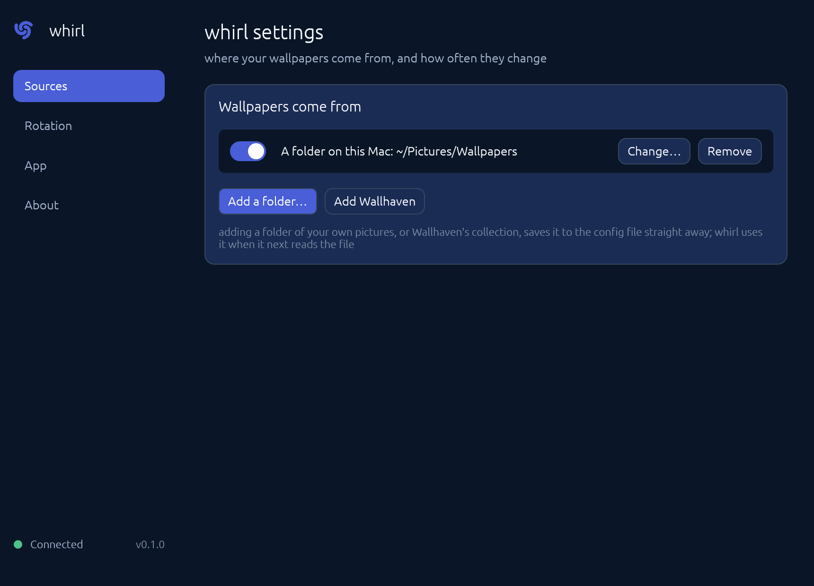

# Whirl

Wallpaper that rotates on a schedule, from folders you choose, from the menu bar.

Whirl puts the [whirl](https://github.com/guruor/whirl) wallpaper daemon on the menu bar. The daemon is
headless: it owns the wallpaper, the rotation, the sources and every piece of state, and this app is an
ordinary client of it, which owns none of that. The app writes no state file, calls no platform setter,
and holds no copy of the configuration it did not read back through the protocol. Its one part in the
daemon's lifecycle is the daemon's own command: when the daemon is not answering, the menu bar item
offers a `Start whirl` row, and the settings window's Background Helper pane offers `Launch at login`
(which runs `whirl daemon install` or `whirl daemon uninstall`) and, while the unit is loaded and
stopped, `Start now` (which runs `whirl daemon start`). The app never writes a unit file, never unlinks
a socket and never kills a process. Its whole obligation to the daemon is whirl's
[`docs/architecture.md` section
8](https://github.com/guruor/whirl/blob/main/docs/architecture.md#8-frontend-contract), "Frontend
contract", which lists what a frontend may rely on and what it must never do.

## Install

One command installs the daemon and the app, and reuses a daemon that is already there. It downloads
two archives, checks each against the sha256 published beside it, and writes nothing until both checks
pass. It uses no root and asks no question. Read it first:

    curl -fsSLO https://raw.githubusercontent.com/guruor/whirl-ui/v0.2.4/install.sh
    less install.sh
    sh install.sh

The same thing as one line, for anyone who has read it and trusts it:

    curl -fsSL https://raw.githubusercontent.com/guruor/whirl-ui/v0.2.4/install.sh | sh

The daemon goes into `~/.local/bin` and `Whirl.app` into `/Applications`, which is outside your home:
that one write is the only step macOS may ask you to authorize, and the script prints what may be asked
and why rather than driving or dismissing that dialog. Whirl is not notarized, so its first launch may
report that macOS cannot check it: open it once from Applications and allow it under
System Settings > Privacy & Security if asked.

What was installed is recorded in a receipt (`WHIRL_UI_RECEIPT`, by default
`~/Library/Application Support/whirl-ui/install.receipt`), and `uninstall.sh` removes the paths in that
receipt and nothing else; the script prints that one undo command when it finishes. A daemon or app
that was already here was reused, not installed, and both scripts leave it alone: `uninstall.sh` never
kills a process it did not start, and it names what it deliberately leaves alone, the daemon's config,
state, cache and log. The daemon's own login unit is whirl's to install and whirl's to remove, so
neither script writes a unit file. [`docs/installation.md`](docs/installation.md) is the long version:
both routes step by step, and the paths either one touches.

### A release candidate

`install.sh` carries the two releases it installs as defaults of its own, and it takes no arguments:
anything but `--help` exits 2, and `scripts/check-release-pins.sh` checks those two defaults before
anything is built. A prerelease therefore reaches a machine by the channel below or by an environment
override, and the overrides are listed in the script's header.

The daemon at a candidate, with the app left at its release:

    WHIRL_VERSION=v0.2.2-rc.3 sh install.sh

Both halves at candidates. The two repositories write the value differently, which is the one thing to
get right: the app's default is the bare version number and its tag is that number with a `v` in front,
while the daemon's default already carries the `v`. So the tag `v0.2.5-rc.1` is
`WHIRL_UI_VERSION=0.2.5-rc.1`:

    WHIRL_UI_VERSION=0.2.5-rc.1 WHIRL_VERSION=v0.2.2-rc.3 sh install.sh

### The unstable build

`WHIRL_CHANNEL=unstable` installs the newest prerelease of each repository, app and daemon together. It
reads both repositories' release lists, prints the two tags it settled on, and installs that pair. The
script has to be one that reads the channel: `v0.2.5-rc.1` carries it and so does `main`, while a script
from an older tag, `v0.2.4` included, does not read `WHIRL_CHANNEL` at all and would install the pinned
pair with the variable sitting unread.

    curl -fsSLO https://raw.githubusercontent.com/guruor/whirl-ui/v0.2.5-rc.1/install.sh
    less install.sh
    WHIRL_CHANNEL=unstable sh install.sh

What that printed when this section was written (2026-10-11), before it downloaded either archive:

    channel:  unstable, resolved before either archive is downloaded
      app        v0.2.5-rc.1   the newest prerelease of guruor/whirl-ui
      daemon     v0.2.2-rc.3   the newest prerelease of guruor/whirl
      note       a channel makes a run non-reproducible, so both tags are printed here
                 and written with the receipt: this is the pair this run installs.

Read those lines as part of the install. An unstable pair is not reproducible: it is whatever each
repository's newest prerelease is on the day the command runs, and the two repositories are released
independently. `unstable` is also not "the newest build of each repository", because a release can
follow its own prerelease: the daemon published `v0.2.2` after `v0.2.2-rc.3`, so the channel reaches
for `v0.2.2-rc.3` while the released pair pins the older daemon `v0.2.1`. The pair that was installed
is in the receipt and not only in the terminal:

    grep -E 'channel|app-tag|daemon-tag' ~/Library/Application\ Support/whirl-ui/install.receipt

Going back to the released pair is two commands, and the first one is the one that matters:

    sh uninstall.sh
    sh install.sh

`sh install.sh` on its own is not the way back: it replaces the app with the pinned release, and it
reuses a daemon that is the pinned release or newer, which the candidate's daemon is, so the candidate
daemon would stay. What a run does when it cannot resolve is stop rather than fall back: with no
prerelease published in a repository, with a channel value the script does not know, and with a version
override beside a channel, `install.sh` installs nothing and says which of those it was.

What the candidate the channel currently resolves carries is in
[`docs/releases/v0.2.5-rc.1.md`](docs/releases/v0.2.5-rc.1.md).

## Features

- Rotation on a schedule. The interval is the daemon's; the app shows the one in use.
- Sources from your own folders, and Wallhaven's collection, each switched on or off without leaving
  the config file.
- Three menu bar states: running, paused, and the daemon unreachable, where the item says so and the
  rows that need the daemon are disabled.
- Start at login, through the app's own login item.
- No account, and no telemetry.
- The app is optional: whirl runs and rotates the wallpaper without it, and keeps rotating if the app
  is quit.

## How it fits together

The daemon and the app are two programs and one socket. The daemon listens, owns the state and does the
rotating; the app connects to the socket, reads `status`, follows `subscribe` for change notification
and sends the daemon's own verbs back to it. The app is an ordinary client with no privileged access
and no side channel, and whirl's
[`docs/architecture.md` section
8](https://github.com/guruor/whirl/blob/main/docs/architecture.md#8-frontend-contract) is the contract
it is written to.

## Docs

- [`docs/installation.md`](docs/installation.md): both install routes, step by step.
- [`docs/design.md`](docs/design.md): the visual language, and what each element the design draws would
  cost in config.
- [`docs/releases/v0.2.4.md`](docs/releases/v0.2.4.md): what this build is, what its first launch needs,
  and what it does not do.
- [whirl's docs](https://github.com/guruor/whirl/tree/main/docs): the daemon's own side of the socket,
  its architecture and its protocol.

## Contributing

Development material lives in [`CONTRIBUTING.md`](CONTRIBUTING.md): the toolchain, the checks a pull
request must pass, the verify verbs and the release path.

## Licence

MIT. See [LICENSE](LICENSE).
